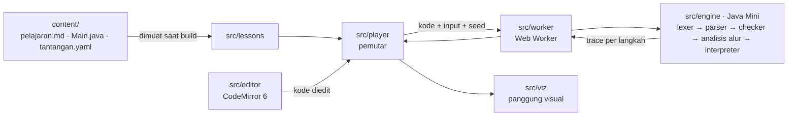

# Algoritma & Pemrograman · Java

Web app pembelajaran visual untuk mahasiswa. Program Java dijalankan **langkah demi langkah** di browser: geser slider untuk melihat isi memori pada setiap langkah, sementara kode sumbernya selalu terlihat di samping. Begitu kode diedit, termasuk bila sebaris dihapus, program dijalankan ulang dan animasinya ikut berubah.

Bahasanya Java karena tipenya tegas (*strong typing*). Mahasiswa melihat setiap variabel sebagai kotak bertipe (`int`, `double`, `char`, `String`, array) dan mendapat error kompilasi yang sama dengan `javac`.

> **Tersedia sekarang:**
> - Modul 1 *Algoritma & Pemrograman Dasar*: 15 pelajaran, 30 tantangan.
> - Modul 3 *Strategi Algoritma*: 16 pelajaran, 32 tantangan, dengan grafik pertumbuhan untuk analisis kompleksitas.
> - Ruang Coba.
>
> Modul 2 *Struktur Data* menunggu perluasan mesin Fase 2 (class/objek, koleksi, exception); lihat [roadmap](#roadmap).

## Fitur utama

- **Pemutar langkah**
  - Slider, tombol ⏮ ◀ ▶ ⏭, dan putar otomatis 0.5×–4×.
  - Keyboard: ←/→ (Shift untuk 10 langkah), Home/End, Spasi untuk putar/jeda.
  - Tanda pada slider: hijau berarti variabel yang dipantau berubah, biru berarti ada output, merah berarti exception.
- **Kode dan animasi selalu sinkron**
  - Baris yang baru dijalankan disorot, dan baris yang tidak pernah dijalankan dipudarkan.
  - Klik nomor baris untuk melompat ke eksekusi berikutnya dari baris itu.
- **Edit langsung.** Setelah 400 ms berhenti mengetik, program dijalankan ulang di Web Worker dan posisi langkah dipertahankan. Contohnya, hapus `maks = nilai[i];` lalu lihat nilai maksimum tidak pernah diperbarui.
- **Penjelasan setiap langkah dalam Bahasa Indonesia**
  - Contoh: "`7 / 2` = 3 karena keduanya int: sisa pembagian dibuang".
  - Catatan dosen muncul tepat saat baris yang ditandai dijalankan.
- **Error seperti javac, lengkap dengan penjelasan.** Teks pesan, nomor baris, dan posisi caret identik dengan `javac` 21. Setiap error dilengkapi *Artinya* dan *Saran* dalam Bahasa Indonesia.
- **Visualisasi**
  - Call stack dan memori: kotak variabel bertipe dan panah referensi ke heap.
  - Array (sel atau batang, dengan penunjuk indeks dan rentang aktif) dan array 2D (termasuk tabel dynamic programming berlabel dan papan catur).
  - Pohon panggilan untuk rekursi, divide and conquer, memoisasi, dan backtracking.
  - Graf dari matriks ketetanggaan: bobot, simpul yang sudah dikunjungi, dan label jarak.
  - Evaluasi ekspresi, misalnya `nilai[i] > maks` → `7 > 9` → `false`.
  - Konsol, buffer input Scanner, dan String sebagai deretan karakter.
- **Grafik pertumbuhan (analisis kompleksitas)**
  - Program dijalankan ulang untuk beberapa ukuran n.
  - Hasilnya dibandingkan dengan kurva O(1) sampai O(2ⁿ) dan disimpulkan, misalnya "naik 4× saat n 2× → O(n²)".
  - Grafik diperbarui setiap kali kode diedit.
- **Tantangan yang dinilai otomatis.** Pemeriksaan mencakup output, nilai akhir variabel, konstruksi yang wajib atau dilarang dipakai, jumlah langkah, dan kelas kompleksitas. Petunjuk dibuka bertahap.
- **Ruang Coba.** Editor bebas dengan visual otomatis dan panel input.
- **Tanpa server**
  - Seluruh mesin berjalan di browser.
  - Progres dan kode yang diedit tersimpan di `localStorage`.
  - Tema terang/gelap mengikuti sistem operasi.
- **Aksesibel**
  - Lighthouse Accessibility 100 di semua halaman, pada tema terang dan gelap.
  - Bisa dioperasikan penuh dengan keyboard, kontras memenuhi WCAG AA.
  - Menghormati `prefers-reduced-motion`.

Tampilan dirancang untuk laptop/desktop dengan lebar ≥ 1100 px; sudah diuji dari 1366×657 sampai 1920×1080.

## Mulai cepat

Butuh **Node.js 24** dan **pnpm 10**.

```bash
pnpm install
pnpm dev          # buka http://localhost:5173
```

Perubahan berkas materi di `content/` langsung terlihat di browser setelah disimpan.

## Perintah

| Perintah | Fungsi |
|---|---|
| `pnpm dev` | Server pengembangan dengan *hot reload* |
| `pnpm build` | Typecheck + build produksi ke `dist/` |
| `pnpm preview` | Menyajikan hasil build secara lokal |
| `pnpm typecheck` / `pnpm lint` | Pemeriksaan tipe TypeScript / ESLint |
| `pnpm test` | Unit test (Vitest) |
| `pnpm cek-konten` | Validasi semua materi di `content/` (lihat [Panduan Dosen](docs/PANDUAN-DOSEN.md)) |
| `pnpm uji:diferensial` | Membandingkan mesin dengan JDK 21 asli; butuh `javac` dan `java` 21 di `PATH` |
| `pnpm e2e` | Uji end-to-end Playwright terhadap build produksi. Jalankan `pnpm exec playwright install chromium` sekali sebelumnya |

## Deploy

`pnpm build` menghasilkan situs statis murni di `dist/`, tanpa backend dan tanpa basis data. Salin isi folder itu ke server web mana pun:

- server kampus (Apache, Nginx, IIS), termasuk dari subfolder seperti `https://kampus.ac.id/prodi/algoritma/`;
- GitHub Pages, Netlify, Cloudflare Pages, dan layanan serupa.

Tidak perlu aturan *rewrite*, karena aplikasi memakai `base: './'` dan *hash routing* (`…/#/modul/modul-1-dasar`).

Berkas harus disajikan lewat HTTP(S). Membuka `index.html` langsung dari disk (`file://`) tidak bisa, karena browser memblokir Web Worker dari origin `file://`.

## Menambah atau mengubah materi

Setiap pelajaran adalah satu folder berisi Markdown, `Main.java`, dan `tantangan.yaml`; tidak ada kode aplikasi yang perlu diubah. Panduan lengkap untuk dosen: **[docs/PANDUAN-DOSEN.md](docs/PANDUAN-DOSEN.md)**.

## Arsitektur



Inti aplikasi adalah interpreter **Java Mini** yang ditulis dari nol dalam TypeScript. Interpreter ini tidak memakai JVM maupun server kompilasi.

1. Setiap run menghasilkan *trace*, yaitu daftar langkah beserta peristiwanya (deklarasi, baca/tulis variabel, evaluasi ekspresi, panggilan method, output, exception).
2. Trace dilengkapi *checkpoint* state setiap 100 langkah, sehingga slider bisa melompat ke langkah mana pun dalam waktu kurang dari 1 ms.
3. Pemutar merekonstruksi state langkah yang dipilih.
4. Renderer di `src/viz` menggambar state itu dengan animasi Motion, memakai `transform`/`opacity` saja.

Spesifikasi lengkap ada di **[docs/DESAIN.md](docs/DESAIN.md)**.

<details>
<summary>Struktur folder</summary>

```
content/             Materi: satu folder per modul, satu subfolder per pelajaran
docs/                DESAIN.md (spesifikasi), PANDUAN-DOSEN.md, mockup pemutar
public/              Ikon, robots.txt
scripts/             cek-konten.ts (validator materi), uji-diferensial.ts (vs JDK 21)
src/
  engine/            Java Mini: lexer, parser, checker, alur (reachability &
                     definite assignment), runtime/interpreter, pustaka Java, narasi
  worker/            Web Worker + klien (timeout 3 dtk, hasil run basi diabaikan)
  player/            Pemutar: store (zustand), bilah kontrol, slider, kartu penjelasan
  viz/               Renderer: memori, array, array2d, evaluasi, konsol, input, string
  editor/            Editor CodeMirror 6: sorotan baris, diagnostik, chip penanda
  lessons/           Skema materi (zod), pemuat, pemeriksa tantangan
  app/               Halaman: Beranda, Modul, Pelajaran, Ruang Coba
  components/, lib/  Komponen UI dasar (shadcn/ui) dan utilitas
tests/
  engine/ lessons/ unit/   Unit test (Vitest)
  korpus/            162 program Java (+ berkas .in) untuk uji diferensial
  korpus-error/      140 program dengan error kompilasi, dibandingkan dengan javac
  e2e/               Skenario Playwright
```

</details>

## Java yang didukung (Fase 1)

**Didukung**
- **Struktur program:** satu berkas `Main.java` berisi `public class Main`, method `static`, serta field `static` / `static final`.
- **Tipe:** delapan tipe primitif, `String`, dan array 1D/2D.
- **Operator:** aritmatika, `++`/`--`, *compound assignment*, relasional, logika, bitwise/shift, ternary, casting.
- **Kontrol alur:**
  - `if`;
  - `switch`, baik klasik maupun `case ->`;
  - `for`, for-each, `while`, `do-while`;
  - `break`, `continue`, `return`.
- **Method:** parameter, nilai kembali, overloading, rekursi.
- **Pustaka:** `System.out.print/println/printf`, `String`, `Math`, `Integer`/`Double`/`Character`, `Arrays`, dan `Scanner`.

**Belum didukung.** Fitur berikut memunculkan pesan ramah beserta alternatifnya: class/objek buatan sendiri, koleksi dan generic, `try/catch`, lambda, `var`. Rinciannya ada di [DESAIN.md §5](docs/DESAIN.md#5-mesin-java-mini).

**Batas pengaman simulator.** Batas ini diberi label `[Simulator]` agar tidak dikira perilaku Java:
- **20.000 langkah** per program (bisa diubah per pelajaran) untuk menangkap perulangan tak berujung;
- **kedalaman rekursi 200**, setelah itu muncul `StackOverflowError`. Stack JVM asli jauh lebih dalam, tetapi stack worker browser terbatas;
- **`Math.random()` memakai *seed* tetap** agar animasi tidak berubah saat kode diedit. Tombol **Acak ulang** mengganti seed-nya;
- **timeout 3 detik** per run;
- array maksimal 10.000 elemen, output maksimal 10.000 karakter.

## Pengujian dan jaminan mutu

- **Uji diferensial terhadap JDK 21**
  - Korpus berisi 302 program: 162 program benar dan 140 program dengan error kompilasi.
  - Setiap program dijalankan dengan `javac`/`java` asli dan dengan Java Mini.
  - Yang dibandingkan: stdout, kelas dan pesan exception, serta baris, teks, dan posisi caret error kompilasi.
  - **Hasil terakhir: 302/302 identik.**
- **Unit test** (Vitest) untuk lexer, parser, checker, analisis alur, runtime, rekonstruksi state per langkah, narasi, dan pemeriksa tantangan.
- **E2E** (Playwright, build produksi)
  - Sinkronisasi slider, sorotan baris, dan penjelasan.
  - Menghapus baris mengubah animasi dan hasil tantangan.
  - Error kompilasi, perulangan tak berujung, dan indeks di luar batas.
  - Progres tersimpan setelah halaman dimuat ulang.
  - Ruang Coba dan tema gelap.
  - Semua pelajaran di semua modul termuat tanpa error, termasuk grafik pertumbuhannya.
- **Validator materi** (`pnpm cek-konten`)
  - Kode awal bisa dikompilasi.
  - Setiap solusi lulus tantangannya, dan kode awal belum lulus sebelum diubah.
  - Setiap penanda catatan punya pasangannya.
- **Kinerja**
  - Kompilasi + eksekusi satu pelajaran < 1 ms (median).
  - Rekonstruksi state ≤ 0,3 ms per langkah.
  - Animasi 60 fps pada build produksi.

Semua pemeriksaan di atas, kecuali kinerja, dijalankan otomatis oleh GitHub Actions ([`.github/workflows/ci.yml`](.github/workflows/ci.yml)) pada setiap push ke `master` dan setiap pull request.

## Roadmap

- **Fase 2 + Modul 2: Struktur Data** (sedang dikerjakan)
  - Mesin:
    - class & objek, `null`, `this`, konstruktor;
    - `try/catch/finally` dan exception buatan sendiri;
    - wrapper/autoboxing;
    - koleksi `java.util` yang meniru JDK 21 sampai ke struktur internalnya;
    - `Comparable` dan lambda `Comparator`.
  - Visual:
    - memori objek dan alur exception;
    - rantai node (linked list), pohon/BST, stack/queue, tabel hash;
    - koleksi dengan tombol "Lihat isi dalam";
    - graf dari daftar ketetanggaan.

Rincian: [DESAIN.md §9](docs/DESAIN.md#9-kurikulum) dan [§11](docs/DESAIN.md#11-fase-2-perluasan-mesin-untuk-struktur-data).

## Teknologi

React 19, TypeScript, Vite, Tailwind CSS 4 + shadcn/ui, CodeMirror 6, Motion, Zustand, Zod, Vitest, Playwright.
