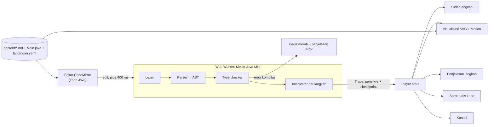

# Desain: Web App Visualisasi Algoritma & Pemrograman (Java)

> Desain yang disetujui untuk Fase 1. Mockup tata letak: [mockup-pemutar.html](./mockup-pemutar.html).

## 1. Masalah & pendekatan

Mahasiswa pemula sulit membayangkan apa yang terjadi di memori saat program Java berjalan, terutama variabel bertipe (*strong typing*), percabangan, perulangan, array, method, dan rekursi.

**Solusi:** web app (laptop/desktop) yang menjalankan kode Java **langkah demi langkah** di browser.
- Setiap langkah menampilkan animasi *state* (kotak variabel bertipe, array, call stack, output) disertai penjelasan berbahasa Indonesia.
- Mahasiswa **menggeser slider** untuk maju atau mundur antarlangkah.
- Kode Java **selalu tampil dan bisa diedit bebas**. Menghapus atau mengubah baris langsung menjalankan ulang program, sehingga animasinya ikut berubah.
- Kesalahan tipe memunculkan error ala `javac` beserta penjelasan dan saran dalam Bahasa Indonesia.

**Pendekatan teknis:** interpreter **"Java Mini"** buatan sendiri (TypeScript) di Web Worker, dengan alur lexer → parser → type checker → interpreter yang merekam *trace*. UI React merender *state* tiap langkah dengan animasi Motion. Semuanya berjalan di browser, tanpa server.

## 2. Keputusan desain

| Topik | Keputusan |
|---|---|
| Bentuk aplikasi | Web app khusus laptop/desktop (target 1280×720; lebar < 1100 px menampilkan pemberitahuan) |
| Bahasa yang diajarkan | Java (subset, semantik Java 21) |
| Edit kode | Bebas penuh; dijalankan ulang otomatis 400 ms setelah berhenti mengetik |
| Interaksi "geser" | Opsi **C**: slider langkah, kode selalu tampil, baris aktif tersorot |
| Eksekusi | Interpreter Java Mini sendiri di Web Worker (dipilih dibanding CheerpJ atau server JDK) |
| Rilis | Bertahap. **Fase 1** = mesin + pemutar + Modul 1 (15 pelajaran) + Ruang Coba |
| Akun | Tanpa login; progres dan kode tersimpan di localStorage; situs statis |
| Latihan | 1–2 tantangan per pelajaran, dicek otomatis |
| Bahasa | UI berbahasa Indonesia; identifier pada contoh kode juga berbahasa Indonesia (`int umur`) |
| Penulisan materi | Dosen menulis file Markdown + Java + YAML di `content/` |
| Animasi | Motion (motion.dev) + SVG/HTML; tanpa GSAP |
| Tema | Terang sebagai bawaan (ramah proyektor) + mode gelap |
| Nama aplikasi | Sementara: "Algoritma & Pemrograman · Java" (bisa diganti) |

## 3. Temuan pencarian skill

- **Lokal** (dipakai saat implementasi; tidak ada yang khusus visualisasi algoritma):
  - `animate` dan `emil-design-eng`: membangun gerak.
  - `apple-design`: rasa seret/geser.
  - `review-animations`: QA animasi.
  - `shadcn`: komponen.
  - `fixing-accessibility`, `web-design-guidelines`, `impeccable`: QA desain.
  - `webapp-testing` / `playwright-cli`: E2E.
  - `deslop`: merapikan kode.
- **Internet (skills.sh):**
  - `greensock/gsap-skills`: resmi, ±60K installs, tetapi tidak dibutuhkan karena arsitektur berbasis *state* per langkah lebih cocok dengan Motion.
  - Skill Manim: menghasilkan video, bukan interaktif.
  - Skill visualisasi algoritma: installs < 15, belum layak dipakai.
  - **Tidak ada skill yang perlu di-install.**

## 4. Arsitektur



**Stack:**
- Inti: Vite, React, TypeScript (strict), pnpm.
- Editor & animasi: CodeMirror 6, Motion.
- State & UI: Zustand, Tailwind CSS v4, shadcn/ui (Radix).
- Navigasi & materi: React Router (HashRouter), react-markdown + remark-gfm, `yaml`, zod.
- Pengujian & skrip: Vitest, Playwright, tsx.

Hasil build berupa situs statis (`base: './'`) yang bisa di-hosting di GitHub Pages, Netlify, Vercel, atau server kampus tanpa konfigurasi.

```
algorithm/
├── content/modul-1-dasar/{modul.yaml, NN-slug/{pelajaran.md, Main.java, tantangan.yaml, solusi/}}
├── docs/            DESAIN.md (salinan desain ini), PANDUAN-DOSEN.md
├── scripts/         cek-konten.ts, uji-diferensial.ts
├── src/
│   ├── engine/      diagnostik/ lexer/ parser/ ast/ checker/ runtime/ pustaka/ trace/ narasi/ index.ts   (murni TS, tanpa DOM)
│   ├── worker/      engine.worker.ts, klienEngine.ts
│   ├── editor/      konfigurasi CodeMirror: warna tipe, baris aktif, diagnostik, penanda #nama
│   ├── player/      store, slider, kontrol, kartu penjelasan, panel Output/Input/Masalah
│   ├── viz/         memori, array, array2d, evaluasi, konsol, input, string, registry
│   ├── lessons/     loader konten, skema zod, render Markdown, pemeriksa tantangan
│   └── app/         routing, halaman, tema, progres (localStorage)
└── tests/           engine/ (Vitest) · korpus/ · korpus-error/ · e2e/ (Playwright)
```

## 5. Mesin Java Mini

### 5.1 Subset Java Fase 1
- **Struktur:**
  - Satu file `Main.java` berisi `public class Main` dan `public static void main(String[] args)`.
  - Method `static` lain, field `static` / `static final`.
  - `import java.util.Scanner;`, `java.util.Arrays`, dan `java.util.*` diterima.
- **Tipe:** `byte short int long float double char boolean`, `String`, array 1D/2D.
- **Literal:** desimal/hex/biner/oktal, garis bawah (`1_000`), akhiran `L`/`f`/`d`, eksponen, char dan string dengan escape (`\n \t \" \\ \' \uXXXX`).
- **Operator:** aritmatika, `++/--` (prefix/postfix), compound assignment, relasional, logika (*short-circuit*), bitwise dan shift, ternary, casting, konkatenasi String.
- **Statement:** deklarasi multi-variabel, blok dan scope, `if/else`, `switch` klasik (fall-through, `default`) dan bentuk `case ->`, `while`, `do-while`, `for`, for-each, `break`, `continue`, `return`.
- **Method:** parameter, `return`, `void`, overloading, rekursi.
- **Pustaka:**
  - Output: `System.out.print/println/printf`, `String.format`.
  - `Math`: abs, max, min, pow, sqrt, round, floor, ceil, random, PI, E.
  - `String`: length, charAt, substring, indexOf, lastIndexOf, contains, equals, equalsIgnoreCase, compareTo, toUpperCase, toLowerCase, trim, isEmpty, startsWith, endsWith, replace, repeat, toCharArray, split (regex sederhana), valueOf.
  - Kelas pembantu: `Integer.parseInt/toString/MAX_VALUE/MIN_VALUE`, `Double.parseDouble`, `Character.isDigit/isLetter/isLetterOrDigit/isUpperCase/isLowerCase/toUpperCase/toLowerCase/getNumericValue`, `Arrays.toString/deepToString/sort/fill/copyOf/equals`.
  - `Scanner`: nextInt, nextLong, nextDouble, nextBoolean, next, nextLine, hasNext, hasNextInt, hasNextLine, close.

### 5.2 Tidak didukung di Fase 1
Fitur berikut memunculkan pesan ramah "belum didukung simulator ini" beserta alternatifnya:
- class/objek buatan sendiri, generic dan koleksi, wrapper/autoboxing, `try/catch/throw` (menyusul di Fase 2);
- inheritance, interface, lambda/stream;
- `var` (sengaja ditolak agar tipe selalu ditulis eksplisit);
- switch expression/`yield`, label pada `break/continue`;
- thread, file I/O, package selain `java.util`, anotasi, text block.

### 5.3 Semantik runtime
Semua perilaku di bawah harus identik dengan Java 21 dan diverifikasi lewat uji diferensial.
- **Representasi angka:**
  - `int` 32-bit dengan wrap (`Math.imul`, `|0`);
  - `long` 64-bit (BigInt `asIntN`);
  - `float` lewat `Math.fround`;
  - `char` 16-bit tak bertanda.
- **Pembagian & sisa:** pembagian bulat memotong ke arah nol; `/ by zero` memicu `ArithmeticException`; tanda `%` mengikuti pembilang; double menghasilkan Infinity/NaN.
- **Casting:**
  - double→int/long di-*clamp*, dan NaN→0;
  - penyempitan int→byte/short/char memotong bit;
  - compound assignment melakukan casting implisit (`x += 3.5` sah untuk `int x`).
- **Format angka:**
  - `Double.toString`/`Float.toString` versi Java, misalnya `0.30000000000000004`, `1.0E7`, `1.0E-4`, `100.0`;
  - `printf %f` membulatkan dengan HALF_UP.
- **String & exception:**
  - String adalah objek imutabel; literal dan konstanta compile-time di-*intern*, sehingga `==` vs `equals` berperilaku seperti Java.
  - Exception yang tidak ditangkap mencetak `Exception in thread "main" java.lang.X: pesan` + `\tat Main.m(Main.java:N)`, lalu program berhenti.
- **Lain-lain:**
  - `Math.random()` memakai *seed* tetap per sesi agar animasi stabil saat kode diedit; ada tombol "Acak ulang".
  - Class publik wajib bernama `Main`, dan method `main` wajib ada. Pesannya mengikuti Java asli.

### 5.4 Type checker & katalog error
- **Format pesan:** `Main.java:N: error: <pesan javac>`, ditambah **Artinya** (penjelasan Indonesia) dan **Saran** (perbaikan konkret). Pesan tampil di tab *Masalah* dan sebagai garis bergelombang di editor.
- **Aturan yang dicek:**
  - konversi assignment (widening, narrowing konstanta ke byte/short/char), promosi numerik;
  - overload resolution;
  - reachability, *definite assignment*, `final`;
  - konteks static, dereference primitif.
- **Error sintaks:** jika ada, hanya error sintaks yang dilaporkan (sama seperti javac).
- **Katalog sintaks:** `';' expected`, `')' expected`, `<identifier> expected`, `illegal start of expression`, `not a statement`, `'else' without 'if'`, `reached end of file while parsing`, `unclosed string literal`, `unclosed character literal`, `integer number too large`, `class, interface, enum, or record expected`.
- **Katalog semantik:** `cannot find symbol`, `incompatible types: X cannot be converted to Y`, `incompatible types: possible lossy conversion from X to Y`, `bad operand types for binary operator`, `bad operand type X for unary operator`, `incomparable types`, `variable x is already defined in method …`, `variable x might not have been initialized`, `cannot assign a value to final variable x`, `missing return statement`, `unreachable statement`, `incompatible types: unexpected return value`, `method m in class Main cannot be applied to given types;`, `no suitable method found for …`, `non-static method … cannot be referenced from a static context`, `int cannot be dereferenced`, `array required, but X found`, `break outside switch or loop`, `continue outside of loop`, `duplicate case label`, `class X is public, should be declared in a file named X.java`.
- Teks pesan diverifikasi terhadap javac 21 lewat `tests/korpus-error/`.

### 5.5 Model langkah & trace
- **Langkah 0** adalah "program siap" (state awal).
- **Satu langkah** = salah satu dari:
  - selesainya 1 statement (efeknya sudah terlihat);
  - 1 evaluasi kondisi (`if`, `while`, `for`, `do-while`, `switch`);
  - pemanggilan method (frame baru);
  - `return` (frame dibuang).
- `for` dipecah menjadi langkah inisialisasi, cek kondisi, dan update. For-each menghasilkan 1 langkah per elemen.
- **Baris yang disorot** adalah baris yang *baru saja dijalankan*.
- **Isi tiap langkah:** baris, jenis langkah, kedalaman call stack, panjang output, dan daftar peristiwa:
  - `deklarasi`, `tulis/baca-var`, `tulis/baca-elemen`;
  - `evaluasi` (pohon ekspresi beserta nilainya);
  - `panggil/kembali`, `alokasi`, `cetak`, `cast`, `overflow`, `baca-input`, `exception`.
- **Penyimpanan:** peristiwa + *checkpoint* state lengkap tiap 100 langkah. `TraceReader.stateAt(i)` merekonstruksi state langkah ke-i dalam waktu < 5 ms, jadi slider bisa melompat ke mana saja, maju maupun mundur.
- **Nilai** disimpan mentah (number/bigint/boolean/ref); tipenya diambil dari tipe statis hasil checker.
- Trace juga menyimpan **state akhir frame `main`** sebelum dibuang, untuk keperluan cek tantangan.

### 5.6 Batas pengaman
Pesan berlabel `[Simulator]` bila bukan perilaku Java.
- **Batas langkah:** 20.000, bisa diubah per pelajaran. Pesannya: "Program dihentikan setelah 20.000 langkah, kemungkinan infinite loop. Baris yang paling sering dijalankan: N."
- **Kedalaman rekursi:** 200, lalu `java.lang.StackOverflowError` disertai catatan `[Simulator]` bahwa batas ini lebih kecil dari JVM asli. Rekursi Java dijalankan dengan rekursi JavaScript, sedangkan stack worker browser jauh lebih kecil dari JVM (diukur ±380 level untuk method bersarang di worker Chromium yang "dingin"). Batas 200 dipilih agar hasilnya sama di semua browser; sebagai jaring pengaman, sisa stack JavaScript juga diperiksa sebelum setiap pemanggilan sehingga simulator tidak pernah mogok dengan `RangeError`. Korpus uji diferensial menghindari rekursi lebih dari 200 tingkat.
- **Ukuran:** array ≤ 10.000 elemen, String ≤ 100.000 karakter, output ≤ 10.000 karakter.
- **Timeout worker:** 3 detik; worker lalu dihentikan dan dibuat ulang.

### 5.7 Narasi otomatis & catatan dosen
- Fungsi murni `narasikan(langkah, stateSebelum, stateSesudah)` menghasilkan kalimat Indonesia, misalnya:
  - "Membuat variabel `umur` bertipe int dengan nilai 20."
  - "Cek kondisi `i < nilai.length` → 3 < 5 bernilai true, masuk ke badan perulangan."
  - "`7 / 2` = 3 karena keduanya int: sisa pembagian dibuang."
  - "Casting `(int) 3.7` → 3: bagian desimal dipotong, bukan dibulatkan."
  - "Overflow! 2147483647 + 1 menjadi −2147483648 karena int hanya 32-bit."
  - "Memanggil `faktorial(3)`: frame baru dibuat dengan n = 3."
- **Catatan dosen:**
  - ditandai dengan komentar penanda `// #nama` di `Main.java`;
  - isinya ditulis di bagian `## Catatan #nama` pada `pelajaran.md`;
  - tampil saat baris bertanda dijalankan. Jika baris itu dihapus mahasiswa, catatannya ikut hilang.

### 5.8 API mesin
- `kompilasi(sumber)` → `{ ok: true, program, penanda } | { ok: false, diagnostik[] }`
- `jalankan(program, { stdin, batasLangkah, batasKedalaman, seed })` → `Trace`
- `new TraceReader(trace).stateAt(i)`, `narasikan(...)`
- `klienEngine.jalankan(sumber, opsi)` → Promise. Setiap run diberi id sehingga hasil yang sudah basi diabaikan; ada timeout + respawn.

## 6. Pemutar pelajaran (lihat `docs/mockup-pemutar.html`)

### Tata letak
- **Header:** identitas aplikasi, breadcrumb, posisi pelajaran, tautan Ruang Coba, tombol tema.
- **Kiri** (±20% lebar layar, 264–340 px, bisa diciutkan): tab Materi | Tantangan (n/m).
- **Tengah:** panggung visualisasi + kartu penjelasan langkah (narasi + catatan dosen, `aria-live="polite"`, dibisukan selama putar otomatis).
- **Kanan** (±50% sisa lebar, 400–640 px, cukup untuk baris 70 karakter di layar 1366 px): editor `Main.java` (✎ bisa diedit, 🎲 Acak ulang bila memakai `Math.random()`, ↺ Reset kode) + tab Output | Input | Masalah.
- **Bawah:**
  - kontrol ⏮ ◀ ▶/⏸ ▶▏ ⏭;
  - slider dengan tanda warna: hijau = variabel di `pantau` (frontmatter) berubah, biru = output, merah = exception;
  - teks "Langkah i / N" dan pilihan kecepatan 0.5×/1×/2×/4× (1× = 1 langkah per 800 ms).

### Perilaku
- **Saat kode diedit:** jeda 400 ms → worker → trace baru. Posisi langkah dipertahankan (dibatasi ke panjang trace baru), dan muncul indikator "Dijalankan ulang · N langkah". Mengubah isi tab Input juga menjalankan ulang program.
- **Error kompilasi:** garis merah di editor dan tab Masalah terbuka. Visualisasi terakhir yang valid dipudarkan dengan label "Animasi dijeda sampai error diperbaiki".
- **Exception runtime:** langkah terakhir menyorot baris penyebab, dan exception tampil di panggung serta di Output.
- **Gerak slider:** menyeret slider merender langkah secara instan; Next/Play memakai transisi beranimasi.
- **Bantuan navigasi:**
  - klik nomor baris → lompat ke eksekusi berikutnya dari baris itu;
  - baris yang tidak pernah dijalankan pada trace saat ini tampil pudar.
- **Keyboard:**
  - saat fokus di luar editor: ←/→ langkah, Shift+←/→ ±10, Home/End, Spasi play/pause;
  - di dalam editor: Alt+←/→.
- **Aksesibilitas:**
  - semua kontrol bisa dioperasikan dengan keyboard, dan fokusnya terlihat;
  - makna warna selalu disertai ikon atau teks;
  - kontras AA;
  - `prefers-reduced-motion` mengganti transisi dengan crossfade singkat.
- **Tema:** mengikuti pengaturan terang/gelap sistem operasi sampai mahasiswa memilih sendiri lewat tombol tema; pilihan disimpan di localStorage. Skrip kecil di `index.html` memasang tema sebelum halaman digambar sehingga tidak ada kedipan.

## 7. Visualisasi

Renderer dipilih lewat `visual:` di frontmatter. Jika variabel yang dirujuk tidak ada (dihapus/diganti nama), tampil "Variabel `x` tidak ditemukan" dan visual kembali ke Memori.

| Renderer | Isi | Pelajaran |
|---|---|---|
| `memori` | Call stack (frame per method), kotak variabel dengan badge tipe berwarna (sama dengan warna tipe di editor), tooltip rentang tipe, char + kode angkanya, panah referensi ke array/String | semua |
| `array` | Sel atau batang, indeks, penunjuk dari variabel int (`penunjuk: [i, j]`), sorotan baca/bandingkan/tulis, penunjuk di luar batas berwarna merah | 11, 13, Modul 3 |
| `array2d` | Grid dengan penunjuk baris/kolom | 12 |
| `evaluasi` | Ekspresi kondisi dengan substitusi nilai, mis. `nilai[i] > maks` → `7 > 9` → false; short-circuit terlihat | 6–9, 11 |
| `konsol` | Output besar di panggung; pola terbentuk per langkah | 1, 10 |
| `input` | Buffer stdin; bagian yang sudah dibaca Scanner ditandai | 5 |
| `string` | Karakter sebagai sel berindeks; mode String sebagai objek di heap (untuk `==` vs `equals`) | 15 |

**Aturan animasi** (mengikuti skill `animate`/`emil-design-eng`, ditinjau dengan `review-animations`):
- **Properti & waktu:** hanya `transform`/`opacity`; durasi 180–320 ms pada 1× (ikut skala kecepatan); `ease-out` untuk masuk/keluar, `ease-in-out` untuk perpindahan; tidak ada `scale(0)` (mulai dari 0.96 + opacity 0).
- **Perubahan nilai:** nilai lama keluar ke atas, nilai baru masuk, disertai kilatan warna sesuai peristiwa.
- **Frame method:** masuk di puncak tumpukan; saat keluar, memudar sambil membawa nilai kembali ke pemanggil.
- **Warna peristiwa:** baca biru, bandingkan oranye, tulis hijau, error merah.
- **Warna tipe:** int biru, double ungu, char oranye-cokelat, boolean hijau, String teal, array abu.

## 8. Materi & tantangan

`pelajaran.md`:
```yaml
---
judul: Mencari nilai maksimum
urutan: 11
ringkasan: Menelusuri array untuk menemukan nilai terbesar.
tujuan: [Menelusuri array dengan for, Memakai variabel penampung maks]
visual:
  - { jenis: array, variabel: nilai, gaya: sel, penunjuk: [i] }
  - { jenis: evaluasi }
  - { jenis: memori }
pantau: [maks]         # perubahan variabel ini ditandai hijau di slider
input: ""              # stdin bawaan untuk Scanner
batasLangkah: 20000
---
## Materi
(Markdown biasa)

## Catatan #banding
Kita hanya mengganti maks bila menemukan nilai yang lebih besar.
```

`tantangan.yaml`:
```yaml
- id: nilai-terkecil
  judul: Cari nilai terkecil
  soal: Ubah program agar mencetak nilai terkecil dari array.
  cek:
    - { jenis: output, input: "", harapan: "Nilai terkecil: 2" }
    - { jenis: variabel, nama: min, tipe: int, harapan: 2 }
    - { jenis: harusMemakai, konstruksi: for }
  petunjuk: [Ganti nama variabel maks menjadi min., Balik operator pembanding pada baris if.]
```

- **Jenis cek:**
  - `output` (persis, per input uji), `outputMemuat`, `outputPola` (regex);
  - `variabel` (nilai akhir di `main`, opsional dengan tipe), `arrayTerurut` (naik/turun);
  - `harusMemakai` / `dilarangMemakai`: `for`, `while`, `do-while`, `for-each`, `if`, `switch`, `ternary`, `casting`, `array`, `break`, `continue`, `rekursi`, `scanner`, `method:<nama>`, `pustaka:<Kelas.method>` (mis. `pustaka:Math.random`, `pustaka:String.charAt`);
  - `tanpaError`, `maksLangkah`.
- **Hasil cek:** ditampilkan per butir (✔/✘ + pesan Indonesia); petunjuk dibuka bertahap; status lulus disimpan di localStorage.
- **Folder `solusi/`:** hanya dibaca oleh validator, tidak ikut ter-bundle.
- **`pnpm cek-konten` memastikan:**
  - skema zod valid;
  - kode awal bisa dikompilasi;
  - setiap solusi lulus semua cek;
  - kode awal belum langsung lulus tantangan;
  - setiap penanda `#nama` punya pasangan `## Catatan #nama`, dan sebaliknya.
- **`docs/PANDUAN-DOSEN.md`:** cara menambah pelajaran langkah demi langkah.

## 9. Kurikulum

### Modul 1: Algoritma & Pemrograman Dasar (Fase 1)
| # | Pelajaran | Inti materi | Visual | Contoh tantangan |
|---|---|---|---|---|
| 1 | Program Java pertama | struktur class/main, statement & `;`, `println` vs `print`, urutan eksekusi | konsol, memori | Cetak biodata 3 baris (`outputPola`) |
| 2 | Variabel & tipe data | deklarasi, inisialisasi, 8 primitif + String, penamaan, `final` | memori (tooltip rentang) | `double ipk = 3.75` lalu cetak (`variabel` + tipe) |
| 3 | Strong typing & casting | widening otomatis, narrowing wajib casting, *lossy conversion*, `(int) 3.7`, char ↔ int, overflow | memori, evaluasi | Perbaiki error tipe dengan casting |
| 4 | Operator & ekspresi | aritmatika, `/` int vs double, `%`, `++/--`, compound, presedensi, relasional & logika | evaluasi, memori | Rata-rata 3 nilai sebagai double |
| 5 | Input dengan Scanner | `nextInt/nextDouble/nextLine`, jebakan `nextLine` setelah `nextInt` | input, memori | Luas persegi panjang (beberapa input uji) |
| 6 | if / else if / else | kondisi, relasional & logika, nested if, cabang yang dilewati | evaluasi, memori | Nilai angka → huruf A–E |
| 7 | switch | `case`, `break`, fall-through, `default`, `case ->` | evaluasi | Nama hari dari angka 1–7 |
| 8 | Perulangan for | inisialisasi/kondisi/update, jejak `i`, off-by-one | evaluasi, memori | Jumlah bilangan genap 1..n |
| 9 | while & do-while | cek awal vs akhir, sentinel, infinite loop & batas langkah | evaluasi, memori | Jumlah digit sebuah bilangan |
| 10 | Perulangan bersarang | pola bintang, tabel perkalian | konsol, memori | Segitiga terbalik tinggi 4 |
| 11 | Array 1 dimensi | `new int[n]`, nilai default, indeks, `.length`, maks/min, pencarian linear, out of bounds | array, evaluasi, memori | Nilai terkecil; jumlah nilai ≥ 75 |
| 12 | Array 2 dimensi | matriks, baris/kolom, loop bersarang | array2d | Jumlah diagonal utama |
| 13 | Method | parameter, return, `void`, scope, pass-by-value (primitif vs array), overloading | memori (call stack + referensi) | `luasLingkaran(double r)` |
| 14 | Rekursi & call stack | base case, faktorial, fibonacci, StackOverflowError | memori (call stack) | `pangkat(a, n)` rekursif tanpa loop |
| 15 | String | objek imutabel, method umum, `==` vs `equals`, membalik string | string, memori (heap) | Cek palindrom |

Ditambah halaman **Ruang Coba**: editor bebas dengan visual otomatis (memori, array, evaluasi, konsol) dan panel input.

### Roadmap (di luar eksekusi Fase 1)
- **Fase 2: Modul 2 Struktur Data.**
  - Mesin: class & objek (`this`, `null`, static nested class), heap/referensi, koleksi generik bawaan, autoboxing, `try/catch`.
  - Renderer: node + panah (linked list), stack/queue, tabel hash, pohon/BST, heap, graf.
  - Materi: ArrayList, Linked List, Stack, Queue, HashMap, Tree/BST, Heap/PriorityQueue, Graph.
- **Fase 3: Modul 3 Strategi Algoritma.**
  - Mesin: penghitung operasi untuk kompleksitas (grafik pertumbuhan).
  - Renderer: batang untuk sorting, tabel DP, papan backtracking, graf berbobot.
  - Materi: brute force, searching (linear, binary), sorting (bubble, selection, insertion, merge, quick), divide & conquer, greedy (koin, activity selection, Dijkstra), DP (fibonacci memo, knapsack 0/1, LCS), backtracking (N-Queens, subset sum), BFS/DFS.

## 10. Pengujian & kualitas
- **Unit (Vitest):**
  - lexer; parser (snapshot AST); checker (minimal 1 tes per entri katalog error);
  - runtime: overflow, pembagian, casting, format angka, identitas String, Scanner;
  - trace: `stateAt(i)` sama dengan state dari eksekusi langsung untuk setiap i;
  - narasi.
- **Uji diferensial vs JDK 21** (`pnpm uji:diferensial`):
  - ≥ 100 program di `tests/korpus/` (+ file `.in` untuk stdin) dijalankan dengan `javac -g` + `java` asli dan dengan mesin kita;
  - stdout harus identik, dan kelas + pesan exception dibandingkan;
  - untuk `tests/korpus-error/`, baris dan teks error pertama harus sama dengan javac.
- **Validator konten:** `pnpm cek-konten`.
- **E2E** (Playwright, Chromium, 1280×720):
  - play/seret slider ↔ sorotan baris & penjelasan tetap sinkron;
  - hapus `maks = nilai[i];` → output dan animasi berubah, tantangan gagal;
  - `int maks = 3.5;` → error + penjelasan, animasi dijeda;
  - infinite loop → pesan batas langkah;
  - tantangan lulus → progres masih ada setelah reload;
  - Ruang Coba.
- **QA desain:** `review-animations`, `fixing-accessibility`, `web-design-guidelines`, `impeccable`; cek tema terang untuk proyektor.
- **Target performa:** kompilasi + jalan pelajaran biasa < 100 ms; `stateAt` < 5 ms; animasi 60 fps.

